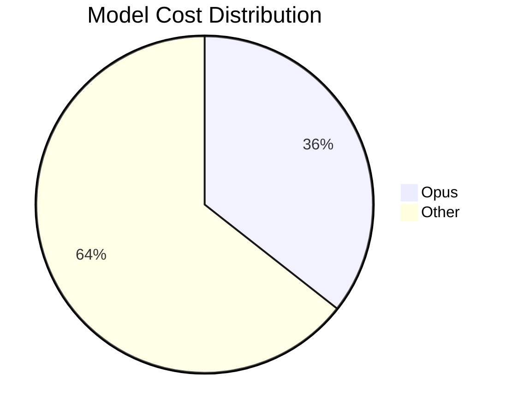
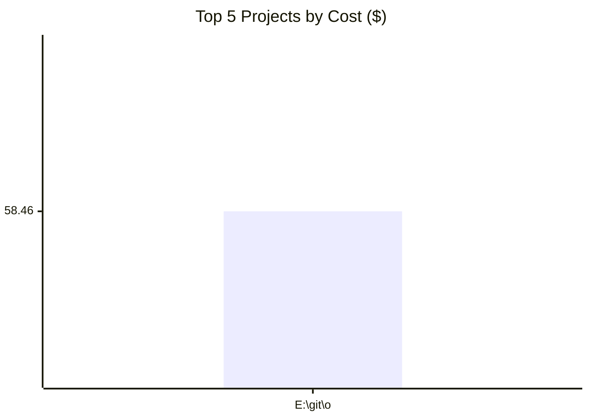
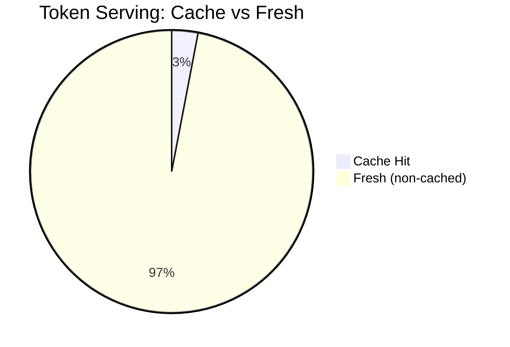
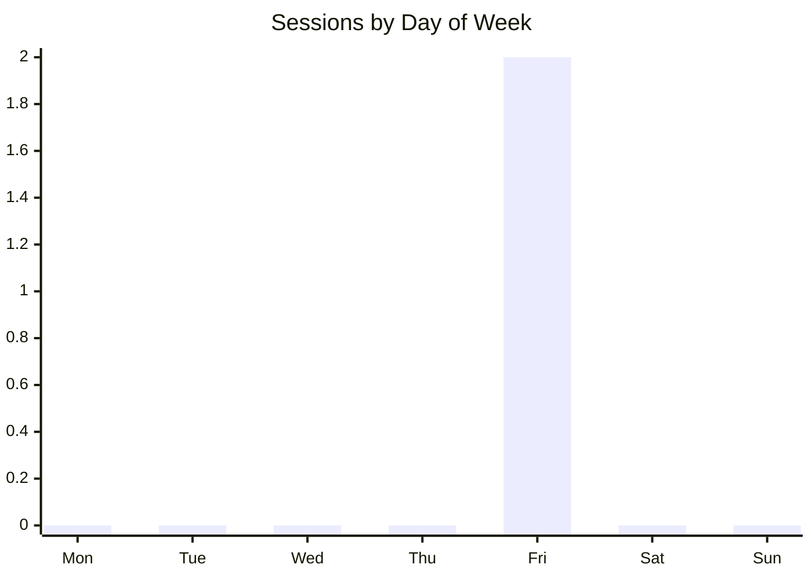
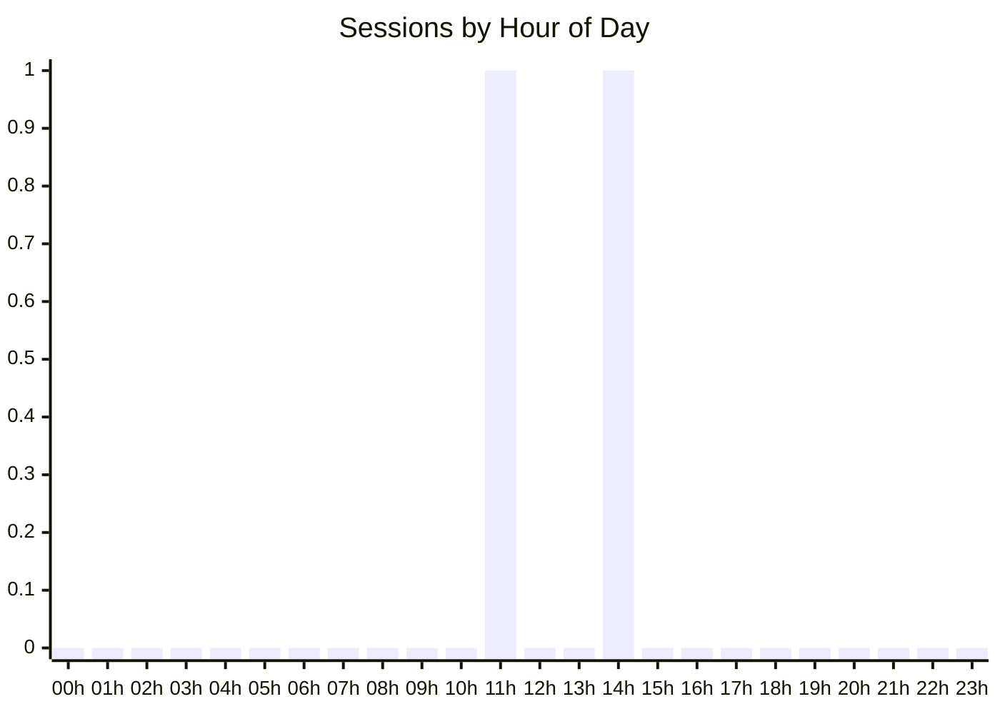
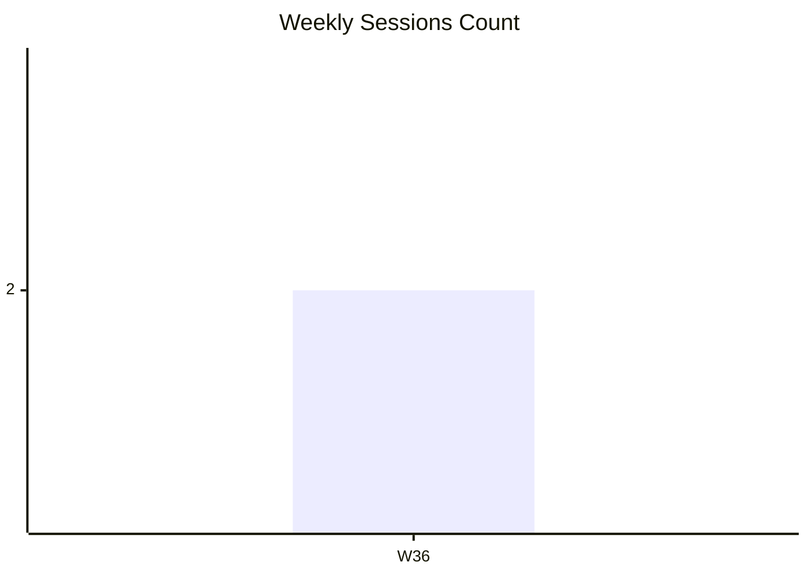

# Token Usage Analytics Report

Generated: 2026-09-04 22:37:43
Period: 2026-09-04 → 2026-09-04
Source: context-stats v1.25.0

## Executive Summary

| Metric | Value |
|--------|-------|
| Report Period | 2026-09-04 → 2026-09-04 |
| Total Spend | $58.46 |
| Total Sessions | 2 |
| Projects Analyzed | 1 |
| Cache Hit Ratio | 3.0% |
| Avg Session Cost | $29.23 |
| Avg Session Duration | 5h 25m 7s |
| Most Expensive Session | 4705f5ef... ($37.65, 64.4% of total) |
| Most Expensive Project | E:\git\orientvibeNg ($58.46, 100.0% of total) |

## Model Usage Breakdown



| Model Family | Sessions | Total Tokens | Cost | % of Total Cost |
|---|---|---|---|---|
| opus | 1 | 4,880 | $20.81 | 35.6% |
| other | 1 | 64,333 | $37.65 | 64.4% |

## Cost Optimization Analysis

### Key Findings

- **Real Sessions**: 2 sessions costing $58.46
- **Cache Hit Ratio**: 3.0% (room for improvement if <70%)

- **Cost per 1k tokens**: $0.845

### Top Cost Drivers (Top 10 Sessions)
| Session | Project | Cost | Cache % | Duration | Input | Output |
|---------|---------|------|---------|----------|-------|--------|
| 4705f5ef... | E:\git\orientvibeNg | $37.65 | 0% | 8h 6m 44s | 64,333 | 0 |
| 11be8a98... | E:\git\orientvibeNg | $20.81 | 41% | 2h 43m 30s | 2,050 | 784 |

### Optimization Opportunities

2. **Sessions with low cache efficiency** (avg 0%)
   - These sessions could benefit most from optimized prompts:

     - 4705f5ef... (E:\git\orientvibeNg): 0% cache hit

3. **Model efficiency by family**
   | Model | Sessions | $/1k tokens |
   |-------|----------|-------------|
   | opus | 1 | $4.264 |
   | other | 1 | $0.585 |

4. **High-spend projects to review**
   | Project | Sessions | Cost | Cache Hit % |
   |---------|----------|------|-------------|
   | E:\git\orientvibeNg | 2 | $58.46 | 3% |



## Cost Efficiency



- **Overall cache efficiency**: 3.0% of tokens served from cache
- **Average tokens per dollar**: 1184 tokens/$

### Top 5 Most Efficient Sessions (lowest $/1k tokens)
|  Session | Project | $/1k tokens | Cost | Tokens |
|---|---|---|---|---|
| 4705f5ef... | E:\git\orientvibeNg | $0.585 | $37.65 | 64,333 |
| 11be8a98... | E:\git\orientvibeNg | $4.264 | $20.81 | 4,880 |

### Top 5 Least Efficient Sessions (highest $/1k tokens)
| Session | Project | $/1k tokens | Cost | Tokens |
|---|---|---|---|---|
| 11be8a98... | E:\git\orientvibeNg | $4.264 | $20.81 | 4,880 |
| 4705f5ef... | E:\git\orientvibeNg | $0.585 | $37.65 | 64,333 |

## Daily Activity Heatmap



### Sessions by Day of Week
| Day | Count | Activity |
|-----|-------|----------|
| Mon | 0 | .................... |
| Tue | 0 | .................... |
| Wed | 0 | .................... |
| Thu | 0 | .................... |
| Fri | 2 | #################### |
| Sat | 0 | .................... |
| Sun | 0 | .................... |



### Sessions by Hour of Day
| Hour | Count | Activity |
|------|-------|----------|
| 00 | 0 | .................... |
| 01 | 0 | .................... |
| 02 | 0 | .................... |
| 03 | 0 | .................... |
| 04 | 0 | .................... |
| 05 | 0 | .................... |
| 06 | 0 | .................... |
| 07 | 0 | .................... |
| 08 | 0 | .................... |
| 09 | 0 | .................... |
| 10 | 0 | .................... |
| 11 | 1 | #################### |
| 12 | 0 | .................... |
| 13 | 0 | .................... |
| 14 | 1 | #################### |
| 15 | 0 | .................... |
| 16 | 0 | .................... |
| 17 | 0 | .................... |
| 18 | 0 | .................... |
| 19 | 0 | .................... |
| 20 | 0 | .................... |
| 21 | 0 | .................... |
| 22 | 0 | .................... |
| 23 | 0 | .................... |

## Weekly Activity Trend

```mermaid
xychart-beta
    title "Weekly Spend ($)"
    x-axis ["W36"]
    line [58.46]
```



| Week | Sessions | Cost | Tokens | Spend Bar |
|------|----------|------|--------|-----------|
| 2026-W36 | 2 | $58.46 | 69,213 | #################### |

## Code Productivity

> Based on 2 sessions with git activity data.

- **Total lines changed**: 4,653 (+2,667 / -1,986)
- **Lines per dollar**: 79 lines/$
- **Lines per 1k tokens**: 67.2 lines/1k tokens

### Top 5 Projects by Lines/$ Efficiency
| Project | Lines Changed | Cost | Lines/$ |
|---------|--------------|------|---------|
| E:\git\orientvibeNg | 4,653 | $58.46 | 79 |

## Projects

| # | Project | Sessions | Cost | % Total | Tokens | Cache Hit % | Avg Cost | Dominant Model |
|---|---------|----------|------|---------|--------|-------------|----------|----------------|
| 1 | E:\git\orientvibeNg | 2 | $58.46 | 100.0% | 69,213 | 3.0% | $29.23 | opus |

---
*Report generated by context-stats*